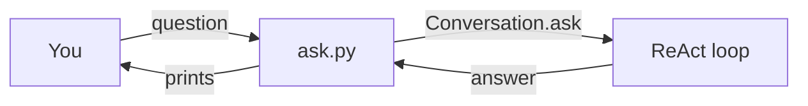
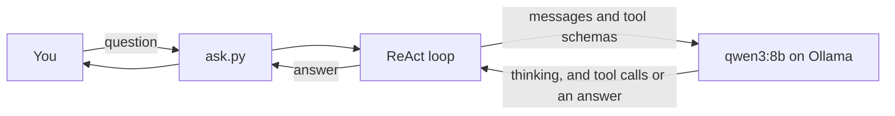
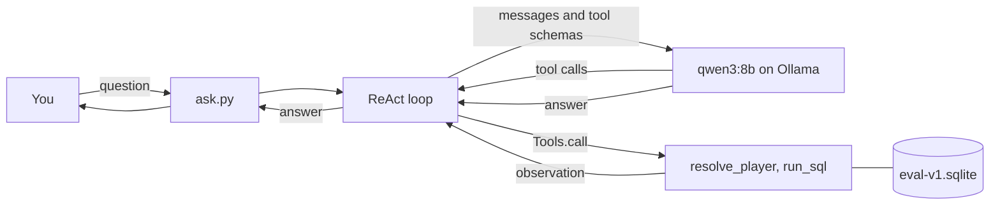
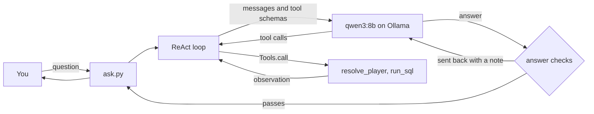

# How the agent works

The agent answers questions about official Brawlhalla results. It's a **ReAct loop**: a language model that reasons, calls a tool, reads the result, and repeats until it can answer. Ours runs qwen3:8b with thinking on, through Ollama's native tool calling. It has two tools, `resolve_player` and `run_sql`, and three guardrails in code, all on the frozen snapshot `eval-v1`.

It's a prototype in three files:
- [`agent/ask.py`](../agent/ask.py): the command you run.
- [`agent/react.py`](../agent/react.py): the system prompt, the loop and the guardrails.
- [`agent/tools.py`](../agent/tools.py): the two tools.

Line references are to commit `2889492`. Some terms used throughout:
- A **step** is one model reply.
- A **turn** is one question's steps, up to 8.
- An **observation** is a tool's result, as the model reads it.
- A **trace** is the record of a turn.



## 1. The entry point: `ask.py`

You run `python agent/ask.py "question"` for one question, or `python agent/ask.py` for a session. `main` does four things before the first question reaches the model ([ask.py:136](../agent/ask.py#L136)):

```python
# agent/ask.py:147-156
header = react.run_header(start, title=f"Agent session {start}")
...
show = (lambda step: [out(line) for line in step_lines(step)]) if args.trace else None
conversation = react.Conversation(react.Tools(), log=lambda *_: None, on_step=show, model=react.MODEL, think=True,
                                  seed=0)
session = Session(conversation, SESSIONS / start, header)
```

- **The run header:** `run_header` asks the Ollama server for its version and the model's details, and reads the snapshot's build ID ([react.py:415](../agent/react.py#L415)). So an unreachable server fails here, with a plain message, not mid-question. The server's address is `OLLAMA_BASE_URL` in `.env`, loaded by `load_env()`.
- **The tools:** `react.Tools()` loads every player alias into memory, which takes about 10 seconds (section 4).
- **The conversation:** `react.Conversation` holds the system prompt and the history (section 3). With `--trace`, `on_step` prints each step as it finishes, through `step_lines` ([ask.py:68](../agent/ask.py#L68)).
- **The session:** `Session` wraps the conversation, and saves the transcript after every question ([ask.py:107-118](../agent/ask.py#L107)):

```python
# agent/ask.py:107-111
def ask(self, question):
    trace = {"turn": len(self.traces) + 1, **self.conversation.ask(question)}
    self.traces.append(trace)
    self.save()
    return trace
```

With no question on the command line, `interactive` reads questions until `exit` or the end of the input ([ask.py:121](../agent/ask.py#L121)). Every question goes to the same `Conversation`, which is how a follow-up like "now only 2v2" sees the question before it. Transcripts go to `data/experiments/sessions/`, which is git-ignored.

`react.py` has its own entry point for experiments: `python agent/react.py --target 8 --seed 0`. Its `run()` starts a fresh `Conversation` for each question ([react.py:403](../agent/react.py#L403)), so target questions never share history.

## 2. The system prompt

The system prompt is one string, `SYSTEM`, at [react.py:51-134](../agent/react.py#L51). It's the first message of every request. `Conversation.__init__` fills in its three numbers: the token budget, the query time limit and the step limit ([react.py:291](../agent/react.py#L291)). It has six parts:

| Part | Lines | What it tells the model |
|---|---|---|
| Using the tools | [55-71](../agent/react.py#L55) | resolve every name before any SQL; what each status means; reduce data in SQL; what a result too large to show looks like |
| Tables | [73-77](../agent/react.py#L73) | `players` (for names) and `event_aliases` |
| Views | [79-99](../agent/react.py#L79) | the eleven views it may query, with their columns |
| Views that hold each pairing more than once | [101-110](../agent/react.py#L101) | how to read the head-to-head views and `v_team_results` from one side |
| Counting rules | [112-122](../agent/react.py#L112) | medals, crew battles, DQs, "best record", "first top 8" |
| Answering | [124-134](../agent/react.py#L124) | the step limit, current names, the scope ("official events, in 1v1"), saying what was assumed |

The views and counting rules are copied word for word from the model comparison's prompt ([`eval/model_comparison.py`](../eval/model_comparison.py)). A test checks they stay identical, so results compare across experiments. The rest was added for the agent, one part per failure the experiments found. For example:

```text
# agent/react.py:63
- resolve_player takes names only, never IDs. To get the name of a player_id, query players with run_sql.
```

The model also sees the tools themselves. `TOOLS` describes each one as a JSON schema: its name, what it does and its one argument ([react.py:136-152](../agent/react.py#L136)). Ollama renders these into the prompt in the format the model was trained on.

## 3. The ReAct loop

The loop lives in `Conversation.turn` ([react.py:309](../agent/react.py#L309)). Each pass is one step: send the messages, read the reply, then either run its tool calls or treat it as the answer.



### How messages are assembled

A request carries the whole conversation as a list of messages. `messages` puts it together on every step ([react.py:295-297](../agent/react.py#L295)):

```python
# agent/react.py:296-297
def messages(self):
    return [self.system, *self.earlier, *self.previous, *self.current]
```

- **`system`:** the prompt from section 2.
- **`current`:** this question so far. It's the question, then each assistant message with its tool calls, then one `tool` message per observation.
- **`previous`:** the question before, kept in full, so a follow-up can reuse its player IDs and queries.
- **`earlier`:** older questions, cut down to the question and the answer ([react.py:299-307](../agent/react.py#L299)). This keeps the context bounded.

### How Ollama is called

`chat` sends one request to Ollama's `/api/chat` ([react.py:174-177](../agent/react.py#L174)):

```python
# agent/react.py:176-177
return ollama("/api/chat", {"model": model, "stream": False, "think": think, "tools": TOOLS, "messages": messages,
                            "options": {**OPTIONS, "seed": seed}}, timeout=REQUEST_SECONDS)
```

- `"tools": TOOLS` is what makes this native tool calling. Ollama puts the schemas in the prompt, and when the model writes a tool call in its trained format, Ollama parses it into structured data. The loop never parses model text itself.
- `"think": True` turns on qwen3's reasoning, which comes back in its own field.
- The seed fixes the sampling, so the same question with the same seed gives the same reply on this server.
- The options give a 32,768-token context and cap each reply at 8,192 tokens ([react.py:44](../agent/react.py#L44)).

### How a reply is read

The reply's `message` has three parts, and the loop takes them apart in one line ([react.py:330](../agent/react.py#L330)):

```python
# agent/react.py:330
thinking, content, calls = message.get("thinking") or "", message.get("content") or "", message.get("tool_calls") or []
```

- `thinking`: the model's reasoning. It's saved in the trace and sent back in the history, but never shown as the answer.
- `content`: the text reply.
- `tool_calls`: a list like `[{"function": {"name": "resolve_player", "arguments": {"name": "marckiemoo"}}}]`.

### How a tool call is run and fed back

If the reply has tool calls, the loop first adds the assistant message to the history, then runs each call in order ([react.py:375-390](../agent/react.py#L375)):

```python
# agent/react.py:379-388, shortened, with comments added
observation = self.tools.call(name, arguments)          # run it
self.shown.observe(name, observation)                   # remember what the model has now seen (section 5)
...
text = json.dumps(observation, ensure_ascii=False)
self.current.append({"role": "tool", "tool_name": name, "content": text})   # feed it back
```

- `Tools.call` sends each call to the right tool by name ([react.py:191-209](../agent/react.py#L191)). A missing argument or an unknown tool name comes back as an `error` observation, so the model can correct itself rather than the loop crashing.
- The assistant message goes into the history with its content emptied ([react.py:373-375](../agent/react.py#L373)). The server's qwen3 template drops a message's tool calls when it also has text, and the model needs to see its own calls.



### When the loop stops

A turn ends in one of four ways:
- **A reply with no tool calls:** `ending()` names the outcome ([react.py:272-278](../agent/react.py#L272)). Text is `answered`, then the two answer checks run (section 5). No text is `empty reply`. A reply cut off at the output cap is `cut off at the output cap`, and a tool call written as text that Ollama didn't parse is flagged as such.
- **The 8th step still calling tools:** the outcome is `step limit`, and those calls aren't run ([react.py:366-372](../agent/react.py#L366)). To head this off, the observation before the last step says "You have one step left" ([react.py:384-385](../agent/react.py#L384)).
- **A request error:** the server couldn't be reached, and the outcome says so.
- **A check sends the answer back:** this doesn't end the turn. It adds a message and runs another step.

## 4. The tools

### `resolve_player(name)`: from a name to a player ID

People write names many ways: "megd" for megD, "marckiemoo" for Marckiem00, "Balloonboy" for a former name of BBBalloonBoy. The resolver turns a name into ranked candidate players. Everything it needs is loaded into memory once, by `Resolver.__init__` ([tools.py:96-109](../agent/tools.py#L96)): each player's current name, their canonical ID after merges, their count of official results, and every alias with its kind.

**Normalization:** names are compared as the builder stores aliases ([ingest/names.py:14-17](../ingest/names.py#L14)). That means no team tag, accents folded, lowercase, letters and digits only:

```python
# ingest/names.py:17
return re.sub(r"[\W_]+", "", fold((name or "").split("|")[-1]))
```

So "M30W | BalloonBoy" becomes `balloonboy`. `normalize_full` keeps the tag (`m30wballoonboy`), and the resolver tries both.

**Matching, in tiers:** the first tier that finds anyone wins ([tools.py:127-143](../agent/tools.py#L127)).

| Tier | Matches | Example |
|---|---|---|
| exact | the normalized name equals an alias; a curated nickname ranks first | "megd" → megD |
| swap | equal after undoing common swaps: `$` as s, digits as letters, l as i, doubled letters as one (`skeleton`, [tools.py:72](../agent/tools.py#L72)) | "baloonboy" → BBBalloonBoy |
| prefix | an alias that starts with it (3+ characters) | "rayd" → Raydish, first of several |
| fuzzy | a similar spelling, difflib ratio 0.8 or more (4+ characters) | "markiemoo" → Marckiem00 |

**Ranking:** candidates sort by tier, then by official results (most first), then by how strong the alias is ([tools.py:147](../agent/tools.py#L147)). Most results first reflects that a question about results is almost always about the active player. Two records are named Impala, with 48 results and 1, so "Impala" ranks the active one first.

**Status** ([tools.py:148-160](../agent/tools.py#L148)):
- `confident`: one match in the best tier, or several of which only one has official results.
- `ambiguous`: several matches with results, a shared name like Boomie, or only prefix and fuzzy matches.
- `not_found`: nothing matched.

Each candidate comes back with its `player_id`, current name, the spelling it matched, how it matched, and its results ([tools.py:164-172](../agent/tools.py#L164)). The prompt tells the model to use the first candidate, and to say so when the status is ambiguous.

### `run_sql(query)`: read-only queries with a budget

`run_sql` opens a fresh connection for each query, and locks it down three ways ([tools.py:201-205](../agent/tools.py#L201)):

```python
# agent/tools.py:201-205
db = sqlite3.connect(Path(path).resolve().as_uri() + "?mode=ro", uri=True)
db.execute("PRAGMA query_only = ON")
db.set_authorizer(lambda action, *_: sqlite3.SQLITE_DENY if action == sqlite3.SQLITE_ATTACH else sqlite3.SQLITE_OK)
deadline = time.monotonic() + seconds
db.set_progress_handler(lambda: 1 if time.monotonic() > deadline else 0, 10000)
```

- **Read-only:** `mode=ro` opens the file read-only, `query_only` refuses writes, and the authorizer refuses `ATTACH`, so no other database file can be reached.
- **Timeout:** SQLite calls the progress handler every 10,000 instructions, and returning 1 interrupts the query. After 30 seconds the model gets an error saying why queries get slow: a player lookup inside the query instead of a literal ID ([tools.py:211-213](../agent/tools.py#L211)).
- **Errors:** an SQL error comes back as an observation, `{"error": "OperationalError: no such column: format"}`, so the model can fix its query.

**The token budget:** every observation stays in the model's context until the answer, so one huge result could crowd out everything else. Every 1v1 set Raydish played is 455 rows and about 28,000 tokens of a 32,768-token context. So `run_sql` adds up each row's estimated cost as it builds the result ([tools.py:217-227](../agent/tools.py#L217)):

```python
# agent/tools.py:220-226
for row in rows:
    values = [cell(v) for v in row]
    size += tokens(json.dumps(values, ensure_ascii=False)) + 1  # and the comma between rows
    if size > TOKEN_BUDGET:  # the note first, before anything else the model reads
        return {"complete": False, "note": TOO_BIG.format(total=total, budget=f"{TOKEN_BUDGET:,}"),
                "row_count": total, "columns": columns}
    out["rows"].append(values)
```

- `tokens()` estimates cost without calling the model ([tools.py:189-194](../agent/tools.py#L189)). Qwen's tokenizer spends a token on almost every digit and JSON punctuation mark, and about one per four characters of other text. Against the server's real counts, that estimate was 9% under to 20% over.
- **Within the budget** (about 4,000 tokens), the result comes back whole: `{"complete": true, "columns": [...], "rows": [...], "row_count": 46}`.
- **Over it,** no rows come back at all. The model gets the row count, the columns and a note to reduce the result in SQL, for example with `GROUP BY` or `LIMIT`.
- Cells are kept short ([tools.py:181-186](../agent/tools.py#L181)): floats are rounded to 4 places, and text is cut at 300 characters.

## 5. The guardrails in code

The prompt asks for good behavior. These three checks enforce some of it, because the experiments showed the model doesn't always follow the prompt.



### Refusing IDs in `resolve_player`

In the first prototype run, the model passed a player ID to `resolve_player` to get a name. The character swaps and fuzzy matching then turned "71736" into a different player, tike36, and the answer named him. Now `as_player_id` spots an ID before any matching ([tools.py:80-90](../agent/tools.py#L80)): digits only ("71736", "#71736"), or written out ("player_id 71736"). `resolve` returns an error that says how to get the name instead ([tools.py:114-118](../agent/tools.py#L114)):

```python
# agent/tools.py:116-118
return {"name": name, "error": f"{name!r} looks like a player_id, not a name, and resolve_player takes names"
                              f" only. To get a player_id's name, use run_sql: SELECT player_id, name FROM"
                              f" players WHERE player_id = {number}"}
```

### Sending back an answer that follows a result too large to show

A result over the budget has no rows, so an answer straight after it can't rest on data. The loop keeps a flag, `too_big`, which every `run_sql` call sets or clears ([react.py:382-383](../agent/react.py#L382)). Only a new query clears it, not a name lookup. When an answer arrives while it's set, the loop sends it back ([react.py:338-347](../agent/react.py#L338)):

```python
# agent/react.py:338-342, with a comment added
if outcome == "answered" and too_big:
    if number + 2 <= max_steps:                       # room to query again, then answer
        step["size_check"] = {"action": "sent back", "message": TOO_BIG_ANSWER}
        self.current += [{"role": "assistant", "content": content, "thinking": thinking},
                         {"role": "user", "content": TOO_BIG_ANSWER}]
```

The send-back keeps the rejected answer in the history and adds a short user message explaining why. Without two steps left, the answer is kept, and the trace flags it (`answered_after_too_big`). So far this check has never fired: no result in 18 runs was over the budget.

### Checking for players no tool returned

A model can invent a name when it has only an ID: "Kael" for player 37977. The check asks whether the answer names a player that no tool returned in this conversation. It runs in two parts:
- **What the model has been shown.** `Shown` collects every word of the prompt, the questions and the observations. It also collects every player ID a tool returned, as a resolver candidate or as a number in a query result ([react.py:231-254](../agent/react.py#L231)).
- **Where the answer names a player.** Most ordinary words are some player's display name ("best", "me", "Winter" all are), so `name_spans` looks only where a name can be told apart without a dictionary ([react.py:214-228](../agent/react.py#L214)). That means words shaped like gamer tags (tike36, V3M_T4NQUIL0, megD) and short bold text (`**Raydish**`).

`unreturned` flags a span that is the current name of a real player, and isn't a number or a word the conversation already showed. It also checks that none of that name's players were returned ([react.py:256-267](../agent/react.py#L256)). A flagged answer goes back once, with the names, if a step is left ([react.py:348-358](../agent/react.py#L348)). The next answer counts either way, and the trace records what was flagged. So far it fired twice in 36 runs, both times on invented names.

## 6. A worked example: question 8

The question is "Who has the best record against marckiemoo?". This trace is question 8 at seed 0 from run `20261020T011930Z`. It was recorded with the version before the token budget, but every step below runs the same way in the current code.

Through `ask.py`, the question goes `main` → `Session.ask` → `Conversation.ask` → `turn`. The recorded run came through `react.py`'s `run()`, which joins the same path at `Conversation.ask`. `ask` adds the question to `current` and to `Shown`, and `turn` starts its steps.

| Step | Model time | What the model did | Code that ran | Observation |
|---|---|---|---|---|
| 1 | 7.2 s | thought "I need to figure out who marckiemoo is", called `resolve_player("marckiemoo")` | `chat` → `Tools.call` → `Resolver.resolve`: not an ID; the exact tier finds the curated nickname | `confident`: 146052 Marckiem00 |
| 2 | 10.1 s | queried the 1v1 head-to-head view from Marckiem00's side, with at least 5 matches, best win rate first | `run_sql`: read-only, 0.17 s, 1 row, within budget; `Shown.observe` records ID 71736 | `[[71736, 3, 2, 5]]` |
| 3 | 3.4 s | wanted the name of player 71736, and called `resolve_player("71736")` | `as_player_id` → 71736; `resolve` returns the refusal | error, with `SELECT player_id, name FROM players WHERE player_id = 71736` |
| 4 | 4.8 s | ran the name query it was given | `run_sql` | `[["V3M_T4NQUIL0"]]` |
| 5 | 4.8 s | answered | `ending` → `answered`; no result too large to show; `Shown.unreturned` finds nothing | the answer below |

The step 1 observation, as the model read it:

```json
{"name": "marckiemoo", "status": "confident", "note": "Use player_id 146052.",
 "candidates": [{"player_id": 146052, "name": "Marckiem00", "matched": "marckiemoo", "match": "curated nickname",
                 "official_results": 47, "results_from": "2022-05-08", "results_to": "2026-09-27",
                 "note": "Marckiem00, formerly ECHO | Marckiemoo"}]}
```

The step 2 query, written by the model with the literal ID, as the prompt asks:

```sql
SELECT player_id, wins, losses, (wins + losses) as matches FROM v_head_to_head_1v1
WHERE opponent_id = 146052 AND (wins + losses) >= 5
ORDER BY (wins * 1.0 / (wins + losses)) DESC, wins DESC, losses ASC LIMIT 1;
```

It reads the view from one side (`opponent_id = 146052`), as the pairing section of the prompt says. It also multiplies by `1.0` to avoid integer division.

The answer at step 5 passed both checks. `V3M_T4NQUIL0` and `Marckiem00` are gamer-tag shaped, but both had appeared in observations:

> At official events in 1v1, **V3M_T4NQUIL0** has the best record against **Marckiem00** (player_id 146052), with a **3-2 record (60% win rate)** across 5 matches. This is the highest win rate among players with at least 5 matches against Marckiem00.

That's the expected answer from the evaluation set (q08), with its minimum stated. The whole turn took 30.3 s of model time and 0.2 s in the tools.

The prompt grew with each step: 1,892, 2,445, 3,087, 3,354 and 3,670 tokens. That's every step's thinking, call and observation added to the history. Most of it was already in the server's cache: 1,876 of 1,892 tokens at step 1, and 3,355 of 3,670 at step 5. So each request resends the whole conversation, but the server only processes the new part.

## 7. Known limitations

From the [experiment log](experiments.md), on questions 4, 6 and 8 with six seeds each:

- **Questions that read as a list aren't aggregated.** Question 6 ("who has megd played with, and how did they place?") failed in all 6 runs, twice. The model lists rows instead of grouping them in SQL. Reading 46 rows, it gave results to the wrong partner and got the counts wrong. A prompt rule didn't change that. See "2026-10-19: the result-size fixes".
- **Filtering on a value no row has.** Asked about 2v2, the model filters `format = '2v2'`, which never matches: 2v2 is a mode, and `v_team_results` holds only 2v2. It then takes the empty result as fact ("megD never played 2v2"). This happened in 3 of 12 question 6 runs.
- **Pairings read from both sides.** The head-to-head view holds each pairing twice, and the prompt says so. Even so, one answer added both rows (3–3 instead of 2–1), and another swapped the two players' names.
- **SQL slips.** Integer division (`wins / matches` truncates in SQLite) picked the wrong player once. A `COUNT(*)` on a view that already holds one row per pair made every count 1 and emptied a result once.
- **Answers leave things out.** Question 4's answers give the record but never its sets. Every run called BBBalloonBoy by the question's "Balloonboy", and some question 8 answers don't state the 5-match minimum.
- **The answer check is partial by design.** It only looks at words shaped like gamer tags and at bold text, so a plain invented name, such as Raydish written in plain text, isn't checked.
- **The token estimate is approximate.** It's 9% under to 20% over, and a user who really wants a long list has no way to get it yet. The decided design, not built, sends the full table to the user directly instead of through the model.
- **Players whose only names are digits can't be found by name** (464 on eval-v1), since `resolve_player` refuses digits.
- **Small samples:** three questions and six seeds each, judged by hand against the verified evaluation set. Times depend on the server, whose speed varied between runs.
- **The scope:** one model (qwen3:8b), the frozen eval-v1 snapshot, and official events only. The planned design, with LangGraph and an evaluation harness, isn't built yet.

The next fixes waiting on a decision are listed at the end of the latest entry in the [experiment log](experiments.md).
